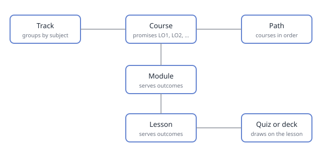

# How a Course Is Built

## What It Serves

- [LO1](welcome-to-the-school.md#lo1): a learner can find a course's page and say who it is for and what it promises.
- [LO2](welcome-to-the-school.md#lo2): a learner can trace a lesson to the outcomes it serves.

## What They Take Away

- **A track** groups the courses that share a subject, and puts them in no order.
- **A course** is a sequence of lessons toward a set of learning outcomes, for the kinds of learner it names. Its page says who it is for, what a learner will be able to do, the modules, how they prove it, and what it deliberately does not teach.
- **A module** groups the lessons of one course that belong together. A course has one or more.
- **A lesson** is one sitting of a course. Its page says which outcomes it serves, what a learner takes away, what they do, and how it is checked.
- **A learning outcome** is something a learner can do after the course, said so it could be checked. Each one is labelled on the course's page: LO1, LO2, and on.
- Every lesson names the outcomes it serves, and every module serves at least one. An outcome no lesson teaches is a promise the course does not keep.
- **A path** is an ordered sequence of courses for one kind of learner toward one outcome. A track groups courses by subject; a path puts them in order.
- **Not This Course** on a course's page says what it leaves out and which course covers it instead. Read it before enrolling, so a course is not taken for one it is not.

## What They Do

Open the catalog, pick any course, and find its learning outcomes. Then open one of its lessons and follow its links back to the outcomes it serves.

## How It Is Checked

The quiz [How a Course Is Built](../../../academy/welcome-to-the-school/how-a-course-is-built.md) in Academy, first in the course [Welcome to the School](../../../academy/welcome-to-the-school/course.md): six questions, drawn from What They Take Away above. Practice as often as you like; an official attempt is kept in your history.

## Materials

The course's kit in Files: a [one-page handout](../../../Files/welcome-to-the-school/index.html) and a diagram of how the pieces fit.

## Notes
